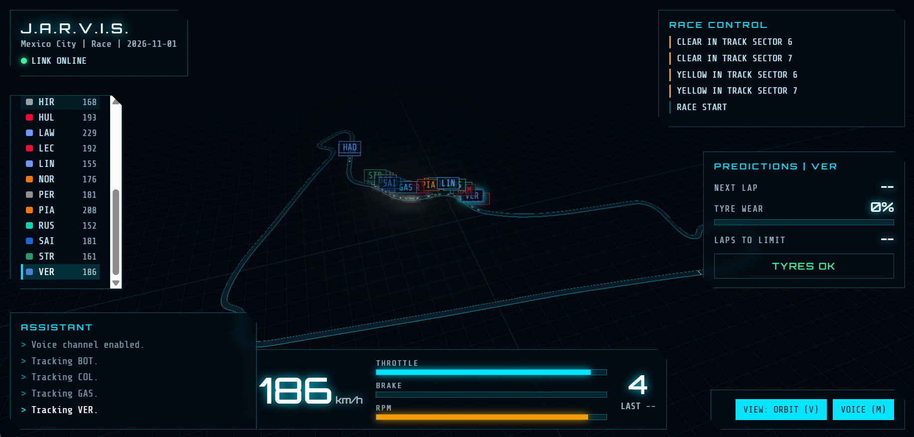

# Sim-Twin-F1

Streaming F1 telemetry pipeline: real race data (OpenF1 API) is replayed into Apache Kafka, stored in TimescaleDB, and monitored with Prometheus and Grafana.

```
OpenF1 API ──► producer ──► Kafka ──► sink ──► TimescaleDB ──► Grafana
                              │
                              ├──► predictor ──► telemetry.predictions
                              │
                              └──► gateway (WebSocket) ──► 3D view + J.A.R.V.I.S. HUD
                       all services ──► Prometheus
```

## How it works

The producer reads a race session from [OpenF1](https://openf1.org) and moves through it at real-time speed (configurable). Every reading is stamped with the time it is sent, so dashboards see a live stream even when the race is over. When the session ends, it starts again from the beginning.

### Kafka topics

| Topic | Content | Key | Partitions | Notes |
|---|---|---|---|---|
| `telemetry.raw` | speed, throttle, brake, gear, RPM, tyre wear | driver | 6 | 1 day retention |
| `telemetry.latest` | same readings | driver | 3 | compacted: last state of each driver |
| `race.laps` | one message per completed lap | driver | 3 | |
| `race.events` | flags, safety car, penalties | `race` | 1 | global ordering |
| `car.position` | x/y/z position on track, for the 3D view | driver | 6 | 1 hour retention |
| `telemetry.predictions` | next lap time, tyre laps left, pit recommendation | driver | 3 | written by the predictor |
| `telemetry.dlq` | invalid messages rejected by the sink | driver | 1 | 7 day retention |
| `telemetry.kpi` | reserved for windowed KPIs | | 3 | not used yet |

### Services

- **producer** (`producer/`): reads OpenF1 and publishes to Kafka. Idempotent producer, `acks=all`, lz4 compression, `source` and `session_key` headers. Metrics on port 8000.
- **sink** (`sink/`): consumer of the `f1-sink` group. Writes batches to TimescaleDB (`telemetry`, `lap`, `race_event`). Offsets are committed manually after the database write (at-least-once). An invalid message is copied to `telemetry.dlq` with the error in a header. Metrics on port 8003.
- **predictor** (`predictor/`): consumer of the `f1-predictor` group. After each completed lap it publishes a next-lap-time forecast (linear trend of recent clean laps), the laps left before tyre wear reaches the limit, and a pit recommendation. A simple statistical model on purpose: `predict()` can be replaced by a trained model. Metrics on port 8002.
- **gateway** (`gateway/`): FastAPI service that streams Kafka to the browser over WebSocket and serves the 3D view. It builds the circuit outline from one clean lap of OpenF1 position data. Open http://localhost:8080.
- **kafka**, **timescaledb**, **prometheus**, **grafana**: infrastructure, defined in `docker-compose.yml`.

## Getting started

Requirements: Docker and Docker Compose.

```bash
docker compose up -d --build
docker compose logs -f producer sink
```

Check that data is flowing:

```bash
docker exec f1-timescaledb psql -U f1 -c "select driver, count(*) from telemetry group by 1"
docker exec f1-kafka /opt/kafka/bin/kafka-console-consumer.sh \
  --bootstrap-server kafka:19092 --topic telemetry.raw --max-messages 5
```

| Service | Address |
|---|---|
| 3D view + J.A.R.V.I.S. | http://localhost:8080 |
| Grafana | http://localhost:3000 (admin / admin) |
| Prometheus | http://localhost:9090 |
| Producer metrics | http://localhost:8000/metrics |
| Sink metrics | http://localhost:8003/metrics |
| Kafka (from host) | localhost:9092 |
| TimescaleDB | localhost:5432 (f1 / f1pass, database `f1`) |

## 3D view



*The 3D view replaying the Mexico City race: live cars on the real circuit, race control messages, the selected driver's telemetry, the predictor panel and the assistant console.*

Open http://localhost:8080 once the producer is running. Cars move around the real circuit; the HUD shows the selected driver's telemetry and the predictor's output, with an assistant console that can read alerts aloud.

| Key | Action |
|---|---|
| `V` | switch chase camera / orbit view |
| `←` `→` | select previous / next driver |
| `M` | toggle voice |

The page loads Three.js from a CDN, so the browser needs internet access. The cars are a stylised low-poly model built in code. `SESSION_KEY` must be the same for the producer and the gateway.

## Producer configuration

Environment variables, set in `docker-compose.yml`:

| Variable | Default | Purpose |
|---|---|---|
| `KAFKA_BROKERS` | `localhost:9092` | broker address (`kafka:19092` inside Docker) |
| `SESSION_KEY` | `latest` | OpenF1 session to replay |
| `DRIVERS` | all | filter by acronym, e.g. `VER,NOR` |
| `SPEED` | `1` | replay speed (`5` = five times faster) |
| `START_MIN` | `0` | minutes after the session start |
| `WINDOW_S` | `5` | seconds of data fetched per API call |
| `LOOP` | `1` | `1` to restart when the session ends |
| `METRICS_PORT` | `8000` | Prometheus port |

## Known limitations

- OpenF1 does not provide tyre temperature: `tyre_temp` is `null`.
- Tyre wear is an estimate (2% per lap, computed from stints and laps), not a measurement.
- Laps and race events are loaded once at startup, so they suit replaying past sessions.
- Following a session that is actually live usually requires a paid OpenF1 account.
- The sink guarantees at-least-once delivery: a duplicate is possible after a failure.
- Predictions are statistical (linear trend, constant wear rate), not a trained model. The wear input is itself an estimate.
- Windowed KPIs (`kpi_window`) are not implemented yet.

## Project layout

```
producer/     producer.py, openf1.py, requirements.txt, Dockerfile
sink/         sink.py, requirements.txt, Dockerfile
predictor/    predictor.py, requirements.txt, Dockerfile
gateway/      app.py, openf1.py, static/index.html (3D view), Dockerfile
docs/         screenshots used in this README
sql/          init.sql (TimescaleDB tables)
prometheus/   prometheus.yml
grafana/      data source provisioning
docker-compose.yml
```
