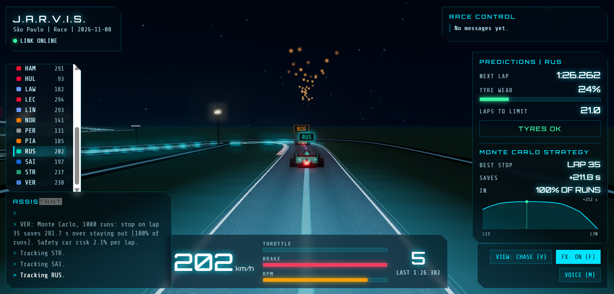
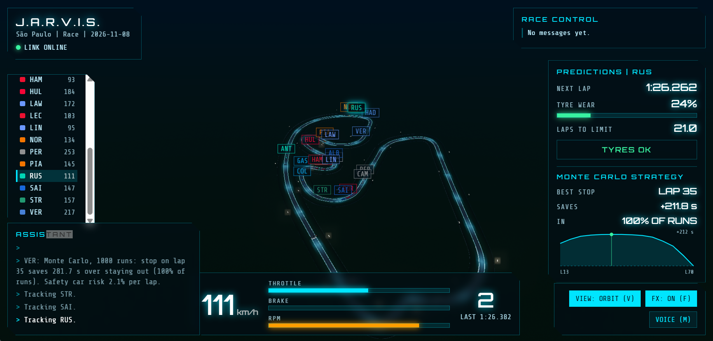
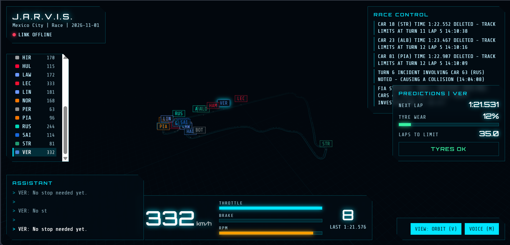
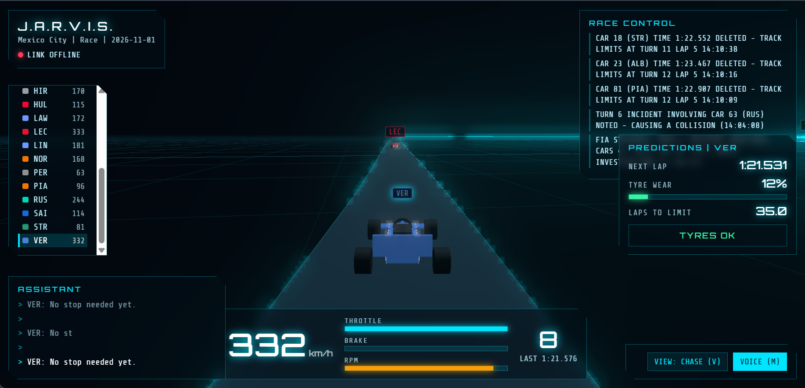

# Sim-Twin-F1

I love Formula 1, and I always wanted to watch a race the way the engineers do: staring at a wall of numbers and pretending to understand all of them. So I built my own pit wall.

Sim-Twin-F1 takes real race data from the OpenF1 API (the Mexico City GP is my test race, because I have commitment issues with other circuits) and replays it through Apache Kafka as if the race were happening right now. Speed, throttle, brake, gears, positions, laps, flags, safety cars: it all flows through the pipeline in real time, and nobody has to wake up at 2 pm on a Sunday.

## 3D view



*The new chase camera on the São Paulo race. The car is braking at 202 km/h (the sparks are not a bug, they are a feature), the floodlights light up the road, and the right-hand panel shows the Monte Carlo strategy for the selected driver: best stop lap, seconds saved, how often it wins and the saved-time curve.*



*The orbit view: the whole circuit from above, every car labelled, and a lap time forecast of 1:26.262 for the selected driver. Yes, that is a traffic jam in the infield.*

### Before the glow-up

For the record, this is what the 3D view looked like when the cars were boxes and the track was a thin cyan line. We do not talk about it much.





What you get, all built in the browser with Three.js and zero image files (the textures are drawn on the fly, so there is nothing to download and nothing to lose):

- **Cars** with a nose, front and rear wings, sidepods, halo, helmet and glossy team paint. The wheels spin with the speed, and the rear light and brake discs glow when the driver stamps on the pedal.
- **Track** with a textured asphalt, kerbs on the inside of corners, tyre walls, a chequered start line, a gantry and floodlights that throw pools of light on the road.
- **Effects**: light trails behind every car (faster means brighter), sparks under heavy braking, and a camera that opens up and rumbles at top speed.

| Key | Action |
|---|---|
| `V` | switch chase camera / orbit view |
| `←` `→` | select previous / next driver |
| `M` | toggle voice (J.A.R.V.I.S. talks to you, you can stop pretending you are not into it) |
| `F` | toggle effects (light trails, brake sparks). Press it if your laptop sounds like a jet engine |

The page loads Three.js from a CDN, so the browser needs internet access. `SESSION_KEY` must be the same for the producer and the gateway, or the gateway will cheerfully draw the wrong circuit.

## Architecture

```
OpenF1 API ──► producer ──► Kafka ──► sink ──► TimescaleDB ──► Grafana
                              │
                              ├──► predictor ──► telemetry.predictions
                              │
                              └──► gateway (WebSocket) ──► 3D view + J.A.R.V.I.S. HUD
                       all services ──► Prometheus
```

In other words: a pipe, a lot of Kafka, and a lot of small services that each do one thing and complain about it in the logs.

## How it works

The producer reads a race session from [OpenF1](https://openf1.org) and moves through it at real-time speed (configurable). Every reading is stamped with the time it is sent, so dashboards see a live stream even when the race is over. When the session ends, it starts again from the beginning, like a very dedicated Groundhog Day.

The producer asks OpenF1 for car data and positions at the same time instead of one after the other, so it spends less time waiting and more time producing. The gateway packs about 50 ms of messages into each WebSocket frame, so your browser gets a tidy parcel instead of a thousand tiny ones.

### Kafka topics

| Topic | Content | Key | Partitions | Notes |
|---|---|---|---|---|
| `telemetry.raw` | speed, throttle, brake, gear, RPM, tyre wear | driver | 6 | 1 day retention |
| `telemetry.latest` | same readings | driver | 3 | compacted: last state of each driver |
| `race.laps` | one message per completed lap | driver | 3 | |
| `race.events` | flags, safety car, penalties | `race` | 1 | global ordering |
| `car.position` | x/y/z position on track, for the 3D view | driver | 6 | 1 hour retention |
| `telemetry.predictions` | next lap time, tyre laps left, pit recommendation, Monte Carlo strategy | driver | 3 | written by the predictor |
| `telemetry.dlq` | invalid messages rejected by the sink | driver | 1 | 7 day retention |
| `telemetry.kpi` | reserved for windowed KPIs | | 3 | not used yet (it is waiting, patiently) |

### Services

- **producer** (`producer/`): reads OpenF1 and publishes to Kafka. Idempotent producer, `acks=all`, lz4 compression, `source` and `session_key` headers. Metrics on port 8000.
- **sink** (`sink/`): consumer of the `f1-sink` group. Writes batches to TimescaleDB (`telemetry`, `lap`, `race_event`). Offsets are committed manually after the database write (at-least-once). An invalid message is copied to `telemetry.dlq` with the error in a header, which is the dead letter queue's way of saying "not today". Metrics on port 8003.
- **predictor** (`predictor/`): consumer of the `f1-predictor` group. After each completed lap it publishes a next-lap-time forecast (linear trend of recent clean laps), the laps left before tyre wear reaches the limit, and a pit recommendation. A simple statistical model on purpose: `predict()` can be replaced by a trained model the day I find the time. Metrics on port 8002.

  It also runs a **Monte Carlo pit-stop simulation** (`predictor/strategy.py`), which is a fancy way of saying "it plays the rest of the race 1000 times and sees what happens". After each lap it compares staying out with stopping at each of the next laps, and publishes the best stop lap, the expected seconds saved and the share of runs where it wins (`mc_best_pit_lap`, `mc_gain_s`, `mc_win_prob`). Every strategy sees the same random tyre degradation and the same safety cars, so the comparison is fair. The safety car rate is learned from the session's own race control messages. The 3D view draws the saved-time curve for the selected driver.

  It needs the race length: the producer sends `total_laps` for a finished session, set `TOTAL_LAPS` for a live one. `PIT_LOSS` sets what a stop costs (22 s by default). The maths has tests in `predictor/test_strategy.py`, because I do not trust anything I have not tried to break.
- **gateway** (`gateway/`): FastAPI service that streams Kafka to the browser over WebSocket and serves the 3D view. It builds the circuit outline from one clean lap of OpenF1 position data. `WS_BATCH_MS` (default 50) sets how long it collects messages before sending a frame. Open http://localhost:8080.
- **kafka**, **timescaledb**, **prometheus**, **grafana**: infrastructure, defined in `docker-compose.yml`. They work hard and ask for very little.

## Getting started

Requirements: Docker and Docker Compose (and a bit of RAM you were not planning to use).

```bash
docker compose up -d --build
docker compose logs -f producer sink
```

Check that data is flowing:

```bash
docker exec f1-timescaledb psql -U f1 -c "select driver, count(*) from telemetry group by 1"
docker exec f1-kafka /opt/kafka/bin/kafka-console-consumer.sh \
  --bootstrap-server kafka:19092 --topic telemetry.raw --max-messages 5
```

If numbers scroll past very fast, that is the point. If nothing scrolls, check the logs and blame Docker first.

| Service | Address |
|---|---|
| 3D view + J.A.R.V.I.S. | http://localhost:8080 |
| Grafana | http://localhost:3000 (admin / admin, yes, I know) |
| Prometheus | http://localhost:9090 |
| Producer metrics | http://localhost:8000/metrics |
| Sink metrics | http://localhost:8003/metrics |
| Kafka (from host) | localhost:9092 |
| TimescaleDB | localhost:5432 (f1 / f1pass, database `f1`) |

## Producer configuration

Environment variables, set in `docker-compose.yml`:

| Variable | Default | Purpose |
|---|---|---|
| `KAFKA_BROKERS` | `localhost:9092` | broker address (`kafka:19092` inside Docker) |
| `SESSION_KEY` | `latest` | OpenF1 session to replay |
| `DRIVERS` | all | filter by acronym, e.g. `VER,NOR` |
| `SPEED` | `1` | replay speed (`5` = five times faster, for the impatient) |
| `START_MIN` | `0` | minutes after the session start |
| `WINDOW_S` | `5` | seconds of data fetched per API call |
| `LOOP` | `1` | `1` to restart when the session ends |
| `METRICS_PORT` | `8000` | Prometheus port |

## Known limitations

Things I know are not perfect, so you do not have to find them and tell me:

- OpenF1 does not provide tyre temperature: `tyre_temp` is `null`.
- Tyre wear is an estimate (2% per lap, computed from stints and laps), not a measurement.
- Laps and race events are loaded once at startup, so they suit replaying past sessions.
- Following a session that is actually live usually requires a paid OpenF1 account.
- The sink guarantees at-least-once delivery: a duplicate is possible after a failure.
- Predictions are statistical (linear trend, constant wear rate), not a trained model. The wear input is itself an estimate, so it is guesses all the way down.
- The strategy simulation models the driver's own race time only: traffic, gaps to other cars and the two-compound rule are not included, and the tyre cliff, fuel effect and pit loss are fixed constants. Read it as the cheapest lap to stop, not a finishing position, and please do not bet money on it.
- Windowed KPIs (`kpi_window`) are not implemented yet.

## Project layout

```
producer/     producer.py, openf1.py, requirements.txt, Dockerfile
sink/         sink.py, requirements.txt, Dockerfile
predictor/    predictor.py, strategy.py, test_strategy.py, requirements.txt, Dockerfile
gateway/      app.py, openf1.py, static/index.html (3D view), Dockerfile
docs/         screenshots used in this README
sql/          init.sql (TimescaleDB tables)
prometheus/   prometheus.yml
grafana/      data source provisioning
docker-compose.yml
```
